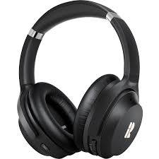
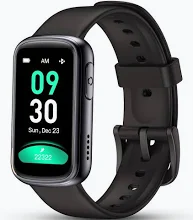
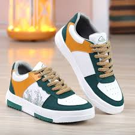
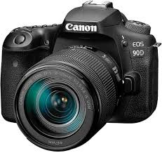
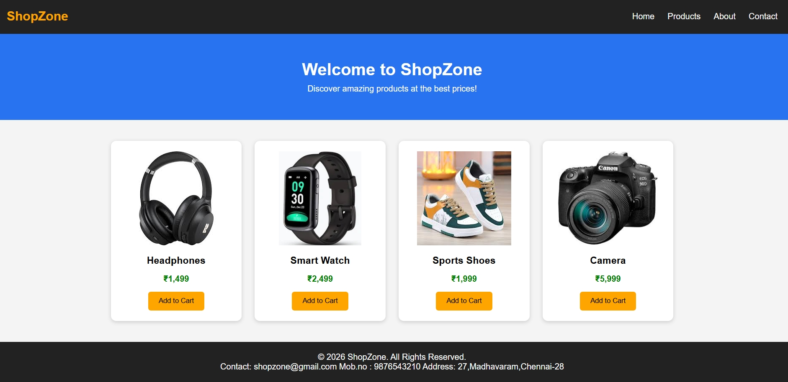

# flexbox
# Ex02 Commercial Website
## Date: 02.11.2026

## AIM
To create a commercial website using CSS Flexbox.

## ALGORITHM
### STEP 1
Create an HTML file (index.html)

### STEP 2
Create a CSS file (style.css)

### STEP 3
Include a navigation bar with links to different sections.

### STEP 4
Add structured sections for Homepage, Products / Services, About Us, Contact Details and User Account.

### STEP 5
Include social media links at the footer with copyright information.

### STEP 6
Define global styles for fonts, colors, and layout.

### STEP 7
Style the header, navigation bar, and sections.

### STEP 8
Use Flexbox for layout design.

### STEP 9
Add hover effects and transitions for interactivity.

### STEP 10
Add Images and Media.

### STEP 11
Use optimized images for a professional look.

### STEP 12
Open the HTML file in a browser to check layout and functionality.

### STEP 13
Fix styling issues and refine content placement.

### STEP 14
Deploy the website.

### STEP 15
Upload to GitHub Pages for free hosting.

## PROGRAM
```


<!DOCTYPE html>
<html>
<head>
    <title>ShopZone - Online Shopping</title>

    <meta name="viewport" content="width=device-width, initial-scale=1.0">

    <style>
        * {
            margin: 0;
            padding: 0;
            box-sizing: border-box;
        }

        body {
            font-family: Arial, sans-serif;
            background-color: #f4f4f4;
        }

        /* Navigation Bar */
        nav {
            background-color: #222;
            color: white;
            padding: 20px;
            display: flex;
            justify-content: space-between;
            align-items: center;
            flex-wrap: wrap;
        }

        nav h2 {
            color: orange;
        }

        nav ul {
            display: flex;
            list-style: none;
            gap: 25px;
        }

        nav a {
            color: white;
            text-decoration: none;
        }

        /* Banner */
        .banner {
            background-color: #2874f0;
            color: white;
            text-align: center;
            padding: 50px 20px;
        }

        .banner h1 {
            margin-bottom: 10px;
        }

        /* Products Section */
        .products {
            display: flex;
            justify-content: center;
            align-items: stretch;
            flex-wrap: wrap;
            gap: 25px;
            padding: 40px 20px;
        }

        .product {
            background-color: white;
            width: 250px;
            padding: 20px;
            text-align: center;
            border-radius: 10px;
            box-shadow: 0 2px 8px #ccc;
        }

        .product img {
            width: 100%;
            height: 180px;
            object-fit: contain;
        }

        .product h3 {
            margin: 15px 0;
        }

        .product p {
            color: green;
            font-weight: bold;
            margin-bottom: 15px;
        }

        .product button {
            background-color: orange;
            border: none;
            padding: 10px 20px;
            cursor: pointer;
            border-radius: 5px;
        }

        .product button:hover {
            background-color: darkorange;
        }

        /* Footer */
        footer {
            background-color: #222;
            color: white;
            text-align: center;
            padding: 20px;
        }

        /* Responsive Design */
        @media (max-width: 600px) {
            nav {
                flex-direction: column;
                gap: 15px;
            }

            nav ul {
                flex-direction: column;
                text-align: center;
                gap: 12px;
            }

            .product {
                width: 100%;
                max-width: 350px;
            }
        }
    </style>
</head>

<body>

    <!-- Navigation Bar -->
    <nav>
        <h2>ShopZone</h2>

        <ul>
            <li><a href="#">Home</a></li>
            <li><a href="#products">Products</a></li>
            <li><a href="#">About</a></li>
            <li><a href="#contact">Contact</a></li>
        </ul>
    </nav>

    <!-- Banner -->
    <section class="banner">
        <h1>Welcome to ShopZone</h1>
        <p>Discover amazing products at the best prices!</p>
    </section>

    <!-- Product Section -->
    <section class="products" id="products">

        <div class="product">
            
            <h3>Headphones</h3>
            <p>₹1,499</p>
            <button onclick="addToCart()">Add to Cart</button>
        </div>

        <div class="product">
            
            <h3>Smart Watch</h3>
            <p>₹2,499</p>
            <button onclick="addToCart()">Add to Cart</button>
        </div>

        <div class="product">
            
            <h3>Sports Shoes</h3>
            <p>₹1,999</p>
            <button onclick="addToCart()">Add to Cart</button>
        </div>

        <div class="product">
            
            <h3>Camera</h3>
            <p>₹5,999</p>
            <button onclick="addToCart()">Add to Cart</button>
        </div>

    </section>

    <!-- Footer -->
    <footer id="contact">
        <p>© 2026 ShopZone. All Rights Reserved.</p>
        <p>Contact: shopzone@gmail.com
           Mob.no : 9876543210
           Address: 27,Madhavaram,Chennai-28
        </p>
    </footer>

    <script>
        function addToCart() {
            alert("Product added to cart successfully!");
        }
    </script>

</body>
</html>


```

## OUTPUT


## RESULT
The program for creating commercial website using CSS Flexbox is executed successfully.